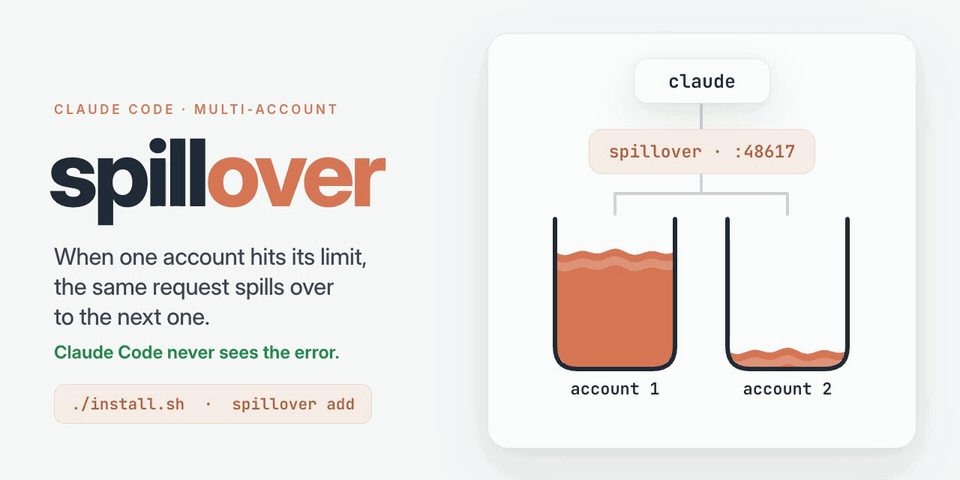

<div align="center">



# spillover

**Several Claude accounts, one Claude Code session.**<br>
When an account hits its usage limit, the same request moves to the next account before Claude Code sees the error.

[](https://github.com/perkarlo/spillover/actions/workflows/ci.yml)
[](https://github.com/perkarlo/spillover/releases)
[](go.mod)
[](LICENSE)

[Quick start](#quick-start) · [How it works](#what-it-does-and-does-not-touch) · [Logins expire](#logins-expire) · [Terms of service](#caveats-read-these) · [FAQ](#faq)

</div>

> [!WARNING]
> Read [Terms of service](#caveats-read-these) before you install. Anthropic's Usage Policy, effective November 12, 2026, names services that route requests through consumer subscriptions and creating multiple accounts to circumvent product guardrails; a breach can end in suspension without notice. You are responsible for your use. Not affiliated with or endorsed by Anthropic.

Use several Claude accounts from **one** Claude Code install, and switch between them automatically when an account's usage limit is hit, without restarting the session or losing its history.

A small local proxy (a single Go binary, standard library only, a few MB of RAM) sits between `claude` and Anthropic's API. It sends each request on the active account's own login. When Anthropic answers that the account's 5-hour or weekly window is spent, the proxy remembers that account until its reset time and **replays the same request on the next account** before Claude Code ever sees the error. To the session nothing happened.

```
claude ──ANTHROPIC_BASE_URL──▶ proxy 127.0.0.1:48617 ──▶ api.anthropic.com
                                 │  active account's token
                                 └─ 429 "rejected"? mark spent, retry on the next account
```

## Quick start

```sh
git clone https://github.com/perkarlo/spillover && cd spillover
./install.sh                                   # builds and starts the background service
echo 'source "$HOME/.local/bin/spillover-shell.sh"' >> ~/.zshrc   # or ~/.bashrc
spillover add                       # sign in another account (browser), repeat per account
```

Open a new terminal and run `claude` as usual. When one account's limit is hit, the next one answers.

## What it does and does not touch

- Only `/v1/messages*` requests are sent on an account's token. Anything else that reaches the proxy goes on untouched with Claude Code's own credentials, and most of Claude Code's other traffic (claude.ai connectors, MCP, artifacts, profile, `/usage`) goes to Anthropic directly without passing the proxy, so all of it stays on the login Claude Code holds.
- It never sets `CLAUDE_CODE_OAUTH_TOKEN` (that makes Claude Code drop its connectors and local MCP servers).
- Accounts are the logins Claude Code already holds: the default one plus every `~/.claude-<name>` config directory that has a login. Tokens are read from the macOS Keychain item Claude Code keeps per config dir, or from `<dir>/.credentials.json`. They are never copied, logged, or exposed by `GET /_status`.
- An expired token is refreshed by running one tiny `claude -p` under that account's directory, so Claude Code stays the only thing that refreshes a login.
- The proxy listens on 127.0.0.1 and answers only requests addressed to the loopback that no browser sent, so a web page cannot use it, even through DNS rebinding.
- If no account can serve a request, it passes through with Claude Code's own login: never worse than no proxy.
- Only a window rejection (`429` with `anthropic-ratelimit-unified-status: rejected`) switches accounts. Ordinary rate limits go back to Claude unchanged.

## Install

Needs Go 1.22+ to build, macOS or Linux. Prebuilt binaries are attached to each [release](../../releases) with a `checksums.txt`; check the one you take with `shasum -a 256 -c checksums.txt --ignore-missing` before `./install.sh --binary <path>`.

```sh
git clone https://github.com/perkarlo/spillover
cd spillover
./install.sh          # builds, installs ~/.local/bin/spillover, starts a launchd / systemd user service
```

Then add the printed line to `~/.zshrc` or `~/.bashrc`:

```sh
source "$HOME/.local/bin/spillover-shell.sh"
```

That defines a `claude` function that points Claude Code at the proxy when it is running and runs plain `claude` when it is not.

On a host without Go, build elsewhere (`GOOS=linux GOARCH=amd64 go build -o spillover .`) or take a release binary, copy it with `install.sh` and `shell.sh` to the host, and run `./install.sh --binary <path>`. `./install.sh --dry-run` prints what it would do.

## Add accounts

```sh
spillover add            # signs in a new account in your browser, names it account-N
spillover add work       # or pick the name
spillover list           # accounts, who they are, which one is active (*), days until each login expires
spillover use work       # send requests on this account from now on, until it is spent
spillover remove work    # sign it out and delete its login from this machine
```

`add` runs Claude Code's own browser sign-in into its own config directory (`~/.claude-<name>`), checks the login landed, tells you which email it is, and warns if you added the same account twice. The running proxy picks it up within 30 seconds; no restart. The default account is whatever plain `claude auth login` signs in. Raw status for scripts: `curl -s http://127.0.0.1:48617/_status`; its `served` field counts the messages replies each account gave since the proxy started, and `loginExpiresAt` (Unix seconds, `null` when unknown) says when a login must be signed in again.

### Logins expire

Claude Code ends a login 30 days after its sign-in, and refreshing the token does not move that date; Claude Code itself warns three days before (`Your login expires in 1 day`). The proxy reads the same date from each login's credential, shows it in `spillover list` and the `LOGIN` column of `spillover usage --all`, and adds `· login <account> 2d3h` to the status line in the last three days. A login past its date is skipped without trying a refresh, and the log says how to sign it in again:

```sh
claude auth login        # the default account (or /login inside Claude Code)
spillover add work       # any other account: signs the same name in again, nothing else changes
```

`use` switches running sessions on their next request, no restart. The choice lives in the proxy's memory: a restart goes back to the default account. Scripts can send `POST /_use` with `{"id": "work"}` (and `"client"` for a `/_c/<client>/` prefix); the endpoint takes JSON only, so a web page cannot switch accounts.

Every switch is logged (`~/Library/Logs/spillover.log` on macOS, the journal on Linux): the account that ran out, when it resets, and the one now serving.

## See how full each account is

```sh
spillover usage            # the active account: 5-hour and weekly window, % used, when each resets
spillover usage --all      # every account in one table, * marks the active one
spillover usage --json     # the same for scripts (with --all, an array)
```

```
  ACCOUNT  EMAIL             LOGIN       5-HOUR  RESETS             WEEKLY  RESETS             WEEKLY BY MODEL
  default  me@example.com    2d3h renew  -       -                  89%     Tue 07:00 (2d8h)   Fable 0%
* work     work@example.com  29d         17%     Sun 01:20 (2h39m)  3%      Wed 11:00 (3d12h)  -
```

`spillover usage` asks Anthropic's usage endpoint (`GET /api/oauth/usage`) once per account with that account's own token, so each account answers for itself. It does not need the proxy; with the proxy stopped, the active account is the default one. `WEEKLY BY MODEL` lists a model's own weekly limit when the plan has one, and `-` means the reply carried no such window. An expired login is refreshed the way the proxy refreshes one, with one tiny `claude -p` on that account. The endpoint is not a documented API and may change.

Claude Code's own `/usage`, `/status` and the plan in the session header always show Claude Code's own login (the default): Claude Code sends those reads to `https://api.anthropic.com` itself, not through `ANTHROPIC_BASE_URL`, so they never reach the proxy. The extra-usage offer Claude Code shows at a limit comes from the same read, so it is for the default login whichever account is active; check which account an offer is for before buying.

### In Claude Code's status line

`spillover statusline` prints the session's account and how full its windows are, for Claude Code's status line:

```
work 5h 17% · wk 3%
work 5h 17% · wk 3% · login default 2d3h
```

The numbers are the `rate_limits` Claude Code hands its status line, read from the headers of the session's last reply. The proxy relayed that reply from the account that answered it, so they are that account's, and no extra request is made. The name is the account the proxy has chosen for the session (with a `/_c/<client>/` base URL, that client's). It prints nothing when the session does not go through the proxy, and `spillover: not running` when the proxy it points at is stopped. After `spillover use`, the numbers follow on the session's next reply.

Use it as the whole status line in `~/.claude/settings.json`:

```json
"statusLine": {"type": "command", "command": "~/.local/bin/spillover statusline"}
```

or call it from your own status line script, which gets the same input on stdin:

```sh
input=$(cat)
account=$(printf '%s' "$input" | ~/.local/bin/spillover statusline)
```

## FAQ

**Does the session keep its context when the account changes?** Yes. The switch happens inside one request: Claude Code keeps the same session, history, tools and MCP servers, and only the account that answers changes.

**Does it work with the Claude desktop app?** No. It works with the `claude` CLI started from a shell that loaded `spillover-shell.sh`; the desktop app is not started from that shell, so its requests never reach the proxy.

**Why does Claude Code's `/usage` still show my first account?** Claude Code sends that read to Anthropic itself, past the proxy. `spillover usage --all` shows every account; see [See how full each account is](#see-how-full-each-account-is).

**Can a website or another machine use my accounts through it?** No. The proxy listens on 127.0.0.1, answers only requests addressed to the loopback that no browser sent, and never puts a token in its output, logs or `/_status`. Reports go through [SECURITY.md](SECURITY.md).

**Windows?** Not supported; macOS and Linux only.

## Options

`spillover serve --port 48617 --upstream https://api.anthropic.com --home ~ --credentials auto|keychain|file`

A request path may begin with `/_c/<client>/` to give a client (an agent, a tool) its own active account; the prefix is stripped before forwarding.

## Caveats, read these

- **Terms of service.** This uses the official `claude` binary with accounts you own, but it routes requests on those subscriptions through a local proxy and moves to the next account when a usage window is spent, and Anthropic's texts can cover that. The [Usage Policy](https://www.anthropic.com/legal/aup), effective November 12, 2026, bars proxying access to Claude through unauthorized means, naming services that route requests through consumer subscriptions, and bars creating multiple accounts to circumvent product guardrails. The [Consumer Terms](https://www.anthropic.com/legal/consumer-terms) bar automated access without an API key or explicit permission and bypassing protective measures; a breach can end in suspension or termination without notice and with no refund. The [log-in article](https://support.claude.com/en/articles/13189465-log-in-to-your-claude-account) says subscription usage is meant for ordinary use of Anthropic's own applications. This is a reading on November 6, 2026, not legal advice. Read them; you are responsible for your use. Not affiliated with or endorsed by Anthropic.
- **Don't copy a login between machines.** Refresh tokens rotate; two machines holding the same one will log each other out. Sign in once per machine.
- **Headless hosts.** On macOS over SSH the Keychain is locked; run the proxy as a user service in the login session (what `install.sh` does).
- The reset time is read from Anthropic's response headers, which are not a documented contract and may change.

## Uninstall

macOS: `launchctl bootout gui/$(id -u)/io.github.perkarlo.spillover; rm ~/Library/LaunchAgents/io.github.perkarlo.spillover.plist`.
Linux: `systemctl --user disable --now spillover`.
Then remove `~/.local/bin/spillover*` and the `source` line from your shell profile. Accounts you added stay as ordinary `~/.claude-<name>` logins; `spillover remove <name>` deletes one.

## Develop

```sh
go vet ./... && test -z "$(gofmt -l .)" && go test ./... && ./.github/checks.sh
```

The rules for changing the code, and the reasons behind them, are in [CLAUDE.md](CLAUDE.md).

## Contributing

Issues and pull requests are welcome: see [CONTRIBUTING.md](CONTRIBUTING.md), and [SECURITY.md](SECURITY.md) for anything security related. Changes are listed in [CHANGELOG.md](CHANGELOG.md).

## Credits and license

This project started as a fork of [limitbreak](https://github.com/radu2lupu/limitbreak) by Radu Lupu. MIT, see [LICENSE](LICENSE).
